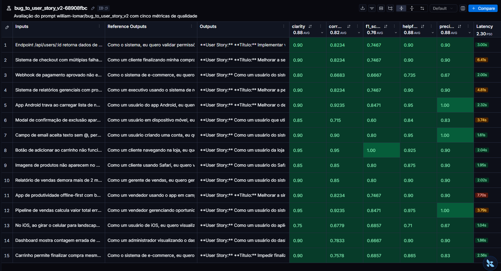
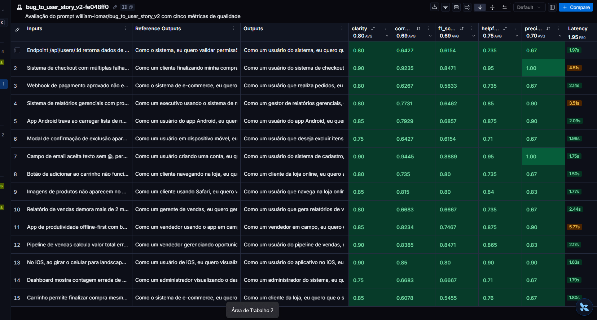
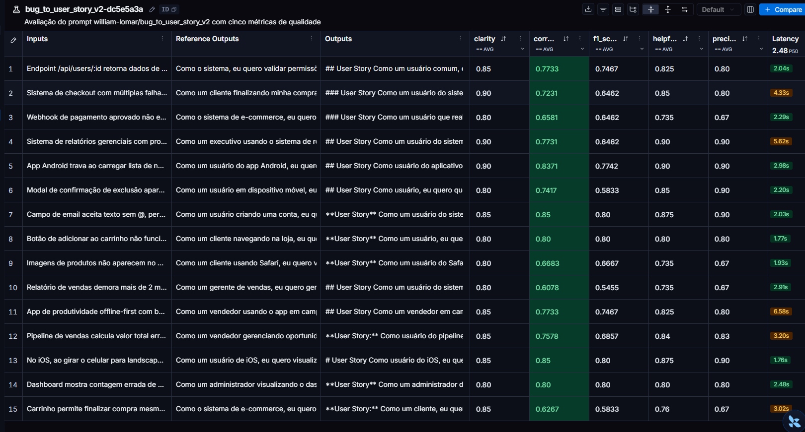
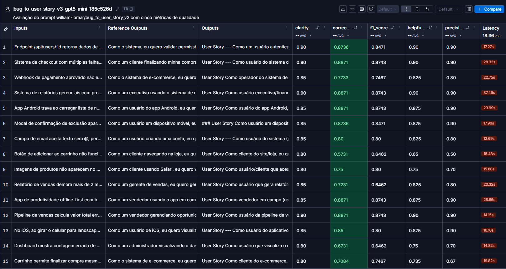
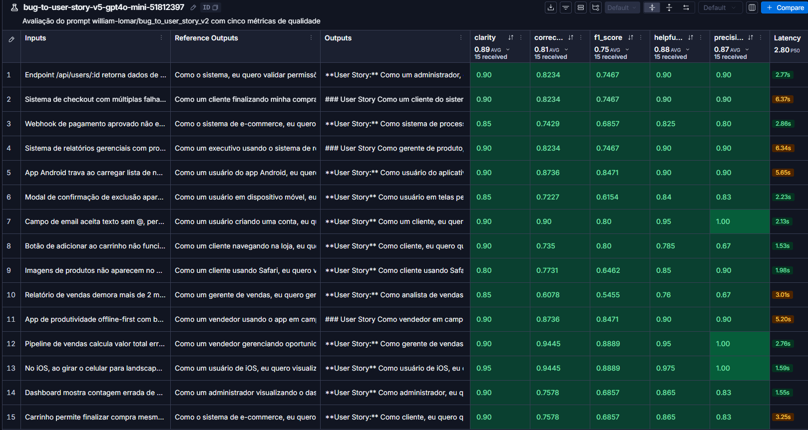
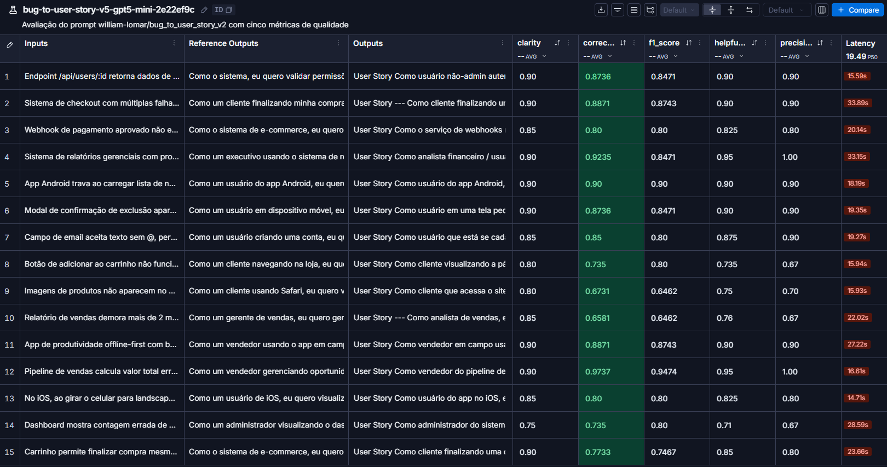

## A) Técnicas Aplicadas (Fase 2)

### Primeira técnica: Few-shot

A primeira técnica aplicada na otimização do prompt foi o **few-shot**, que
consiste em fornecer exemplos de entrada e de resposta esperada para orientar
o modelo. No prompt `bug_to_user_story_v2.yml`, foram incluídos três pares de
relatos de bugs e User Stories, antes da apresentação do novo relato do usuário.

Essa técnica foi escolhida para demonstrar concretamente o formato esperado:
uma User Story no padrão “Como... eu quero... para que...” e critérios de
aceitação verificáveis no padrão “Dado que... Quando... Então...”. Os exemplos
também mostram como ajustar o nível de detalhe à complexidade do bug e quando
incluir uma seção de contexto técnico.

Os três exemplos utilizados foram:

- **Bug simples:** um livro que permanece nos favoritos após a remoção,
  demonstrando uma User Story curta com critérios de aceitação objetivos.
- **Bug com contexto técnico:** uma importação de estoque por CSV que corrompe
  nomes com acentos, demonstrando como preservar as informações técnicas do
  relato e verificar que as quantidades continuam corretas.
- **Bug com múltiplos problemas:** a confirmação de uma reserva que gera
  duplicidade e apresenta um horário incorreto no email, demonstrando como
  agrupar critérios de aceitação para cada problema.

Os exemplos foram criados separadamente do dataset de avaliação. O objetivo
foi ensinar o padrão de resposta, sem fornecer as respostas dos casos usados
para medir a qualidade do prompt. Os resultados da primeira avaliação após
essa alteração estão documentados na Seção B.

### Segunda técnica: Chain of Thought (CoT)

Após a queda das médias na avaliação com few-shot, a segunda estratégia foi
orientar uma **análise interna em etapas (CoT)** antes da geração da User Story.
Nesta iteração, os exemplos few-shot foram removidos do prompt ativo, e as
instruções passaram a guiar a identificação do usuário afetado, a distinção
entre comportamento observado e esperado, a cobertura de todos os problemas,
a elaboração dos critérios de aceitação e a revisão da resposta.

O objetivo é reduzir omissões e inconsistências, especialmente nos relatos
com múltiplos problemas. Por exemplo, em um bug que envolve duplicidade de
reservas e divergência de horário, o modelo é orientado a verificar critérios
para os dois comportamentos antes de finalizar a User Story.

A análise deve ocorrer internamente; a saída contém somente a User Story,
os critérios de aceitação e as seções complementares necessárias. Informações
essenciais ausentes são registradas como pontos a esclarecer, sem inventar
requisitos ou soluções. A avaliação desta versão está registrada na Seção B,
junto dos resultados e dos prompts das iterações anteriores.

## B) Resultados Finais

Comparação entre o prompt original (baseline v1), a primeira otimização com
**few-shot (v2)** e a segunda otimização com **CoT (v3)**, na escala de 0 a 1.
Os valores de v1 e v2 foram transcritos das médias exibidas no cabeçalho dos
prints. Como o cabeçalho de v3 mostra `-- AVG`, suas médias foram calculadas
a partir dos scores dos 15 exemplos visíveis no print.

| Métrica | Original (v1) | Few-shot (v2) | CoT (v3) | Meta ≥ 0,80 na v3 |
| --- | ---: | ---: | ---: | :---: |
| Helpfulness | 0,88 | 0,75 | 0,8203 | Sim |
| Correctness | 0,82 | 0,69 | 0,7494 | Não |
| F1-Score | 0,76 | 0,69 | 0,6980 | Não |
| Clarity | 0,88 | 0,80 | 0,8400 | Sim |
| Precision | 0,88 | 0,70 | 0,8007 | Sim |
| **Média das cinco métricas** | **0,844** | **0,726** | **0,7817** | **Não** |

As médias calculadas usam os valores arredondados dos prints e podem diferir
dos resultados calculados com os scores completos. As médias de v3 e sua média
geral foram arredondadas para quatro casas decimais.
A aprovação exige que **todas as cinco métricas** atinjam pelo menos 0,80.
O prompt original não atingiu a meta de F1-Score. Após o few-shot, apenas Clarity
atingiu a meta, e as cinco médias ficaram abaixo dos resultados originais.
Com CoT, as cinco médias melhoraram em relação aos valores exibidos para
few-shot, e Helpfulness, Clarity e Precision atingiram a meta. A média geral
passou de 0,726 para aproximadamente 0,7817, mas Correctness e F1-Score ainda
ficaram abaixo de 0,80. Portanto, **a versão com CoT ainda não atende ao critério
de aprovação** e permanece abaixo do prompt original nas cinco médias.

### Teste com outro modelo: `gpt-5-mini`

Para verificar se a troca de modelo, sem alterar o prompt, ajudaria a atingir a
meta, o mesmo prompt `bug_to_user_story_v2` (CoT) foi reavaliado com o
`gpt-5-mini` como modelo principal. O modelo de avaliação permaneceu `gpt-4o`,
mantendo a comparação equivalente. O experimento foi registrado no LangSmith com
o prefixo `bug-to-user-story-v3-gpt5-mini`.

| Métrica | CoT com `gpt-4o-mini` | CoT com `gpt-5-mini` | Meta ≥ 0,80 |
| --- | ---: | ---: | :---: |
| Helpfulness | 0,8203 | 0,83 | Sim |
| Correctness | 0,7494 | 0,80 | Sim |
| F1-Score | 0,6980 | 0,79 | Não |
| Clarity | 0,8400 | 0,85 | Sim |
| Precision | 0,8007 | 0,81 | Sim |
| **Média das cinco métricas** | **0,7817** | **0,8175** | **Não** |

**Achado:** apenas a mudança de modelo, com o prompt idêntico, elevou a média
de 0,7817 para 0,8175 e superou a meta de média 0,80. Correctness, que estava
em 0,7494, passou a atingir a meta, e o F1-Score subiu de 0,6980 para 0,79. A
aprovação segue pendente porque o F1-Score ficou 0,01 abaixo de 0,80. O ganho
tem um custo: por ser um modelo de raciocínio, o `gpt-5-mini` consome mais tempo
de processamento do que o `gpt-4o-mini`. A latência mediana (P50) no
LangSmith foi de 18,36 s por exemplo (print `v4-gpt5-mini.png`); não há medição
equivalente registrada para o `gpt-4o-mini`.

Por ser um modelo de raciocínio, o `gpt-5-mini` só aceita `temperature=1`; o
`get_llm` em `src/utils.py` aplica esse valor automaticamente aos modelos
`gpt-5*`, `o1`, `o3` e `o4`. O resultado vem de uma única execução e, com
`temperature=1`, pode variar entre rodadas.

### Refinamento do prompt (v5) e aprovação com `gpt-5-mini`

A partir da análise das respostas mais fracas, o prompt CoT foi refinado em duas
etapas, avaliadas com o `gpt-4o-mini` e, na versão final, também com o
`gpt-5-mini`. O modelo de avaliação permaneceu `gpt-4o`.

**Etapa 1 — corte de excessos (experimento `bug-to-user-story-v4-gpt4o-mini`):**
limites de tamanho por complexidade do relato, proibição de cenários não citados
(filtros, paginação, concorrência, logs) e seções sem conteúdo ou com texto de
preenchimento. Efeito pequeno com o `gpt-4o-mini`, que já respondia de forma
curta: a média foi de 0,7817 para 0,7894. O limite de "no máximo 2 pontos a
esclarecer" virou cota, e o número de itens subiu de 23 para 29.

**Etapa 2 — foco no que a referência cobra (experimento `bug-to-user-story-v5`):**
papel específico na User Story em vez de "usuário" genérico, critérios que
descrevem o resultado correto (e não o limite em que o sistema já falha),
cláusulas "E..." com o comportamento esperado natural da funcionalidade, 2 a 4
critérios por problema e "Pontos a esclarecer" apenas quando essencial.

| Métrica | CoT (`gpt-4o-mini`) | Etapa 1 (`gpt-4o-mini`) | v5 (`gpt-4o-mini`) | v5 (`gpt-5-mini`) | Meta ≥ 0,80 |
| --- | ---: | ---: | ---: | ---: | :---: |
| Helpfulness | 0,8203 | 0,83 | 0,88 | 0,85 | Sim |
| Correctness | 0,7494 | 0,75 | 0,81 | 0,82 | Sim |
| F1-Score | 0,6980 | 0,69 | 0,75 | **0,81** | Sim |
| Clarity | 0,8400 | 0,87 | 0,89 | 0,86 | Sim |
| Precision | 0,8007 | 0,80 | 0,87 | 0,83 | Sim |
| **Média das cinco métricas** | **0,7817** | **0,7894** | **0,8370** | **0,8361** | **Sim** |

Com o `gpt-4o-mini`, o v5 já superou a meta de média (0,8370), mas o F1-Score
ficou em 0,75 e o prompt foi **reprovado**. Com o mesmo prompt e o `gpt-5-mini`,
o F1-Score passou para 0,81 e as cinco métricas atingiram 0,80 ou mais:
**aprovado**.

**Achado: a diferença entre os modelos está em seguir instruções negativas.**
O prompt contém proibições explícitas ("não crie cenários só para confirmar o que
já funciona", "não pergunte sobre versões de navegador"). Comparando as respostas
dos dois modelos ao mesmo prompt:

- No bug das imagens do Safari, o `gpt-4o-mini` escreveu um critério extra
  confirmando que no Chrome as imagens aparecem, exatamente o cenário proibido.
  O `gpt-5-mini` não o criou.
- O `gpt-4o-mini` ignorou a proibição no ponto em que ela importava e a levou ao
  extremo em outro: omitiu "Pontos a esclarecer" nas 15 respostas. O `gpt-5-mini`
  manteve a seção em 3 delas, onde julgou haver uma lacuna, o que se aproxima
  mais do "normalmente omita" pedido.
- As regras negativas não foram seguidas de forma uniforme pelo `gpt-5-mini`: no
  bug das imagens ele perguntou as versões do Safari, o que o prompt vetava, e,
  no relatório de vendas, ambos os modelos usaram o limite de 120 s atual como
  meta, contrariando "nunca o limite em que o sistema já falha". Esses dois
  exemplos seguiram com F1 em torno de 0,55 a 0,65 nos dois modelos.
- O `gpt-5-mini` também produziu critérios mais completos (por exemplo, no modal,
  foco do teclado e bloqueio do menu), em linha com o que as referências
  cobram.

Portanto, a troca de modelo continuou sendo o que levou o F1 acima de 0,80, mas o
ganho veio de o modelo de raciocínio seguir melhor as restrições do prompt, e não
de um prompt diferente.

O custo é o tempo de processamento: nos prints do LangSmith, a latência mediana
(P50) foi de **19,49 s** por exemplo com o `gpt-5-mini`, contra **2,80 s** com o
`gpt-4o-mini`, e as respostas do `gpt-5-mini` têm em média 2.694 caracteres,
contra 1.083.

### Evidências das avaliações

Os três experimentos aparecem nos prints com o nome `bug_to_user_story_v2`.
Nesta comparação, “v1” identifica o resultado original do arquivo
`v1-original.png`, e “v2” identifica o resultado após a otimização do arquivo
`v2-few-shot.png`. “v3” identifica a avaliação com CoT do arquivo `v3-CoT.png`.
São rótulos das etapas, não nomes distintos publicados no Hub.

**Prompt original — experimento `bug_to_user_story_v2-68908fbc`:**

**Mensagem de sistema (`system_prompt`):**

```text
Você é um assistente que ajuda a transformar relatos de bugs de usuários em tarefas para desenvolvedores.

Analise o relato de bug abaixo e crie uma user story a partir dele.

Relato de Bug:
---
{bug_report}
---

User Story gerada:
```

**Mensagem do usuário (`user_prompt`):**

```text
{bug_report}
```



**Após few-shot — experimento `bug_to_user_story_v2-fe048ff0`:**

**Mensagem de sistema (`system_prompt`):**

```text
Você é um assistente que ajuda a transformar relatos de bugs de usuários
em tarefas para desenvolvedores.

Converta o relato recebido em uma User Story em português, seguindo os
exemplos abaixo. Eles demonstram o formato e o nível de detalhe esperado;
use apenas as informações do novo relato, sem copiar os detalhes dos exemplos.
Não invente causas, tecnologias, endpoints ou metas numéricas não informadas.
Retorne somente a User Story e suas seções, sem explicar como a produziu.

EXEMPLO 1 — Relato simples

Relato de Bug:
Na biblioteca digital, clico em "Remover dos favoritos", mas o livro
continua na lista de favoritos mesmo depois de atualizar a página.

Resposta esperada:
Como um leitor da biblioteca digital, eu quero remover livros dos meus
favoritos, para que minha lista reflita os livros que desejo manter salvos.

Critérios de Aceitação:
- Dado que um livro está na minha lista de favoritos
- Quando clico em "Remover dos favoritos"
- Então o livro deve deixar de aparecer nessa lista
- E deve continuar fora da lista depois de atualizar a página

EXEMPLO 2 — Relato com contexto técnico

Relato de Bug:
Ao importar o estoque por CSV separado por ponto e vírgula, os nomes
"Café" e "Açúcar" ficam com caracteres corrompidos. O arquivo está em UTF-8.
A importação termina sem erro e as quantidades permanecem corretas.
Endpoint usado: POST /api/estoque/importar.

Resposta esperada:
Como um responsável pelo estoque, eu quero importar nomes de produtos com
acentos corretamente, para que os registros mantenham os nomes do arquivo
sem comprometer as quantidades importadas.

Critérios de Aceitação:
- Dado que importo um CSV em UTF-8 separado por ponto e vírgula
- Quando o arquivo contém produtos como "Café" e "Açúcar"
- Então os nomes devem ser armazenados e exibidos com os acentos corretos
- E as quantidades devem continuar iguais às informadas no arquivo
- E a importação deve terminar sem erro para esse arquivo válido

Contexto Técnico:
- Endpoint usado: POST /api/estoque/importar
- Formato informado: CSV em UTF-8, separado por ponto e vírgula
- Comportamento observado: nomes corrompidos, com quantidades preservadas

EXEMPLO 3 — Relato com múltiplos problemas

Relato de Bug:
Na reserva de salas, dois cliques rápidos em "Confirmar" criam duas reservas
iguais e enviam dois emails. Além disso, uma reserva para 09:00 no fuso
America/Sao_Paulo aparece como 12:00 no email, embora a tela mostre 09:00.
O backend armazena os horários em UTC. Os dois problemas foram reproduzidos
no mesmo fluxo de confirmação.

Resposta esperada:
Como um usuário que reserva salas, eu quero confirmar uma única reserva
com o horário correto na confirmação, para que eu possa organizar minha
reunião sem duplicidade nem divergência de horário.

Critérios de Aceitação:
Confirmação sem duplicidade:
- Dado que estou confirmando uma reserva de sala
- Quando clico duas vezes rapidamente em "Confirmar"
- Então deve ser criada apenas uma reserva para essa confirmação
- E deve ser enviado apenas um email de confirmação

Consistência de horário:
- Dado que a reserva foi feita para 09:00 no fuso America/Sao_Paulo
- Quando recebo o email de confirmação
- Então o email deve apresentar 09:00 no fuso da reserva
- E o horário deve corresponder ao exibido na tela

Contexto Técnico:
- O backend armazena os horários em UTC
- Os dois problemas ocorrem no fluxo de confirmação de reservas
- O relato não informa a causa da duplicidade nem da divergência de horário

Agora converta o novo relato recebido na mensagem do usuário. Use o padrão
"Como... eu quero... para que..." e critérios verificáveis em
"Dado que... Quando... Então... E...". Ajuste o nível de detalhe à complexidade
do relato e inclua Contexto Técnico apenas quando houver informações técnicas.
```

**Mensagem do usuário (`user_prompt`):**

```text
Relato de Bug:
---
{bug_report}
---
```



**Após CoT (v3) — experimento `bug_to_user_story_v2-dc5e5a3a`:**

**Mensagem de sistema (`system_prompt`):**

```text
Você é um assistente que ajuda a transformar relatos de bugs de usuários
em tarefas para desenvolvedores.

Converta o relato recebido em uma User Story em português. Antes de redigir,
analise internamente o relato em etapas:

1. Identifique quem é afetado, em qual situação o problema ocorre e qual
   impacto impede essa pessoa de alcançar seu objetivo.
2. Diferencie o comportamento observado do comportamento esperado.
   Preserve condições de reprodução, plataformas, valores e restrições
   relevantes fornecidos no relato.
3. Identifique todos os problemas descritos e o resultado esperado para
   cada um. Se houver múltiplos problemas, agrupe os critérios por problema
   para que nenhum seja omitido.
4. Formule a necessidade do usuário e seu benefício no padrão
   "Como... eu quero... para que...", focando no comportamento desejado.
5. Converta cada resultado esperado em critérios de aceitação verificáveis
   no padrão "Dado que... Quando... Então... E...".
6. Confira se a resposta cobre os problemas e detalhes relevantes do relato,
   sem acrescentar requisitos ou soluções não sustentados pelas informações
   recebidas. Revise inconsistências antes de entregar a resposta final.

Use apenas as informações do relato. Não invente causas, tecnologias,
endpoints, metas numéricas ou regras de negócio não informadas. Se faltar
uma informação essencial, registre-a brevemente em "Pontos a esclarecer"
em vez de assumir um valor ou uma solução.

Ajuste o nível de detalhe à complexidade do bug. Inclua "Contexto Técnico"
apenas quando o relato fornecer informações técnicas relevantes, mantendo
clara a diferença entre o sintoma observado e uma causa comprovada.

Retorne somente a resposta final em Markdown, com:
- User Story no padrão "Como... eu quero... para que...".
- Critérios de Aceitação verificáveis, agrupados quando necessário.
- Contexto Técnico, quando houver informações técnicas no relato.
- Pontos a esclarecer, somente quando houver lacunas essenciais.

Não inclua a análise interna, a sequência de raciocínio ou comentários
sobre como a resposta foi produzida.
```

**Mensagem do usuário (`user_prompt`):**

```text
Relato de Bug:
---
{bug_report}
---
```



**CoT com `gpt-5-mini` — experimento `bug-to-user-story-v3-gpt5-mini-185c526d`:**

O print mostra a latência mediana (P50) de 18,36 s por exemplo, com uma faixa de
cerca de 12 s a 37 s entre os 15 exemplos, o que evidencia o tempo adicional do
modelo de raciocínio.



**Prompt refinado (v5) — mensagem de sistema (`system_prompt`):**

```text
Você é um assistente que ajuda a transformar relatos de bugs de usuários
em tarefas para desenvolvedores.

Converta o relato recebido em uma User Story em português. Antes de redigir,
analise internamente o relato em etapas:

1. Identifique quem é afetado, em qual situação o problema ocorre e qual
   impacto impede essa pessoa de alcançar seu objetivo.
2. Diferencie o comportamento observado do comportamento esperado.
   Preserve condições de reprodução, plataformas, valores e restrições
   relevantes fornecidos no relato.
3. Identifique todos os problemas descritos e o resultado esperado para
   cada um. Se houver múltiplos problemas, agrupe os critérios por problema
   para que nenhum seja omitido.
4. Formule a necessidade do usuário e seu benefício no padrão
   "Como... eu quero... para que...", focando no comportamento desejado.
5. Converta cada resultado esperado em critérios de aceitação verificáveis
   no padrão "Dado que... Quando... Então... E...".
6. Confira se a resposta cobre os problemas e detalhes relevantes do relato,
   sem acrescentar requisitos ou soluções não sustentados pelas informações
   recebidas. Revise inconsistências antes de entregar a resposta final.

Use apenas as informações do relato. Não invente causas, tecnologias,
endpoints, regras de negócio ou valores específicos não informados.

Papel na User Story: use o papel mais específico que o relato sugerir
(por exemplo, administrador, gerente de vendas, cliente usando Safari ou
"o sistema" quando a falha for de um processo automático). Evite "usuário"
genérico quando houver uma pista melhor.

Comportamento esperado: os critérios devem descrever o resultado correto,
nunca o defeito atual nem o limite em que o sistema já falha. Além do
ponto exato do relato, inclua, como cláusulas "E...", o comportamento
esperado natural dessa funcionalidade (por exemplo, confirmação ao
usuário, mensagem clara, consistência entre plataformas, acessibilidade
básica), sem criar novos fluxos, regras ou cenários. Se o relato
informar uma meta ou SLA, use-a. Em bugs de desempenho sem meta, exija um
tempo claramente melhor que o observado e sem falhas, sem inventar um
número específico.

Ajuste o tamanho da resposta à complexidade do relato:
- Relato com um único problema (poucas linhas): uma User Story e de 2 a 4
  critérios de aceitação, cada um com as cláusulas "E..." necessárias.
- Relato com vários problemas: um grupo de critérios por problema, cada um
  com as cláusulas "E..." necessárias para cobrir o resultado esperado.
Não repita o mesmo critério com outras palavras, não crie cenários só para
confirmar o que já funciona (por exemplo, "no Chrome funciona") e não crie
blocos de "regras transversais" que reapresentem critérios já escritos.

Crie critérios apenas para o que o relato descreve. Não crie cenários de
filtros, paginação, concorrência, permissões, logs, plataformas ou casos de
borda que o relato não mencione. Inclua "Contexto Técnico" apenas quando o
relato fornecer informações técnicas relevantes, mantendo clara a diferença
entre o sintoma observado e uma causa comprovada.

Retorne somente a resposta final em Markdown, com:
- User Story no padrão "Como... eu quero... para que...".
- Critérios de Aceitação verificáveis, agrupados quando necessário.
- Contexto Técnico, quando houver informações técnicas no relato. Resuma em
  poucas linhas o sintoma, o impacto e os dados técnicos informados
  (endpoints, erros, valores), sem copiar literalmente os passos de
  reprodução.
- Pontos a esclarecer: normalmente omita. Inclua somente quando faltar uma
  informação essencial que impeça escrever critérios verificáveis, e
  limite a 1 ou 2 perguntas. Não pergunte sobre versões de navegador,
  dispositivos, logs ou passos de reprodução que o relato não mencione.

Inclua apenas seções que tenham conteúdo. Nunca escreva uma seção vazia nem
frases como "Nenhum contexto técnico foi fornecido".

Não inclua a análise interna, a sequência de raciocínio ou comentários
sobre como a resposta foi produzida.
```

A mensagem do usuário (`user_prompt`) é a mesma das versões anteriores.

**v5 com `gpt-4o-mini` — experimento `bug-to-user-story-v5-gpt4o-mini-51812397`:**
média 0,8370 e F1-Score 0,75 (reprovado). Latência mediana de 2,80 s.



**v5 com `gpt-5-mini` — experimento `bug-to-user-story-v5-gpt5-mini-2e22ef9c`:**
média 0,8361 e F1-Score 0,81 (aprovado). Latência mediana de 19,49 s. O cabeçalho
do print mostra `-- AVG`; as médias vêm da execução do `evaluate.py`.



C) Seção "Como Executar":

Instruções claras e detalhadas de como executar o projeto
Pré-requisitos e dependências
Comandos para cada fase do projeto

## Executar avaliações no LangSmith

Na raiz do projeto, instale as dependências e configure o `.env` a partir de
`.env.example`. Preencha `LANGSMITH_API_KEY`, `LANGSMITH_PROJECT`,
`USERNAME_LANGSMITH_HUB`, `LLM_PROVIDER`, `LLM_MODEL`, `EVAL_MODEL` e a chave do
provider escolhido (`OPENAI_API_KEY` ou `GOOGLE_API_KEY`).

```powershell
python -m pip install -r requirements.txt
python src/push_prompts.py
python src/evaluate.py
```

Cada execução cria um novo experimento com o prompt
`USERNAME_LANGSMITH_HUB/bug_to_user_story_v2`. O dataset recebe o nome
`LANGSMITH_PROJECT-eval`: se já existir, ele será reutilizado sem sincronizar
alterações posteriores no JSONL local. Para avaliar outro conjunto, use outro
`LANGSMITH_PROJECT` ou atualize o dataset no LangSmith.

O experimento registra a resposta de cada exemplo e os feedbacks `f1_score`,
`clarity`, `precision`, `helpfulness` e `correctness`, com justificativas.
Helpfulness é `(clarity + precision) / 2`; Correctness é
`(f1_score + precision) / 2`. As três métricas base usam o modelo de avaliação
configurado em `EVAL_MODEL`.

O prefixo padrão é o nome do prompt; opcionalmente, configure
`LANGSMITH_EXPERIMENT_PREFIX`. O SDK acrescenta um sufixo único. O terminal
exibe o nome e o link do experimento, além das médias e do status de aprovação.
No LangSmith, acesse **Datasets & Experiments**, abra o dataset e selecione o
experimento. A avaliação publica resultados mesmo quando os scores ficam
abaixo de 0.8; nesse caso, o script termina com código 1. Falhas de geração ou
feedbacks ausentes também impedem aprovação.

A execução faz chamadas ao modelo principal e aos avaliadores, com consumo
de tokens conforme os providers configurados.

Para verificar a integração sem chamadas externas:

```powershell
python -m pytest tests/test_evaluate.py -q
```
